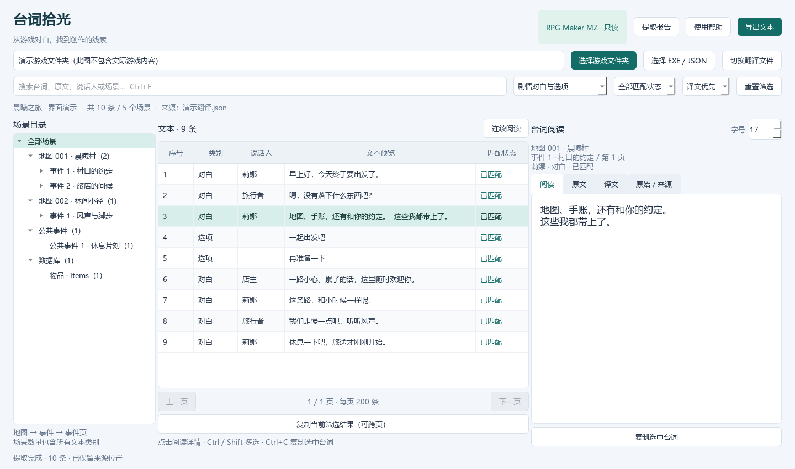

<div align="center">


# 台词拾光

从游戏里提取台词，在一个窗口里阅读、搜索和导出。

[下载 Windows 版](https://github.com/Hirokimeji/rpg-text-reader/releases/latest) · [反馈问题](https://github.com/Hirokimeji/rpg-text-reader/issues)

</div>



*截图中的台词为演示内容。*

支持 RPG Maker、SRPG Studio 和部分 Unity 游戏，也能读取 MTool 翻译文件。提取后可按场景浏览，查看原文与译文，导出 TXT 或 Excel。

程序在本地读取文件，不需要启动游戏，也不会修改游戏数据。

## 下载和使用

适用于 **Windows 10 / 11，64 位**。从 [Releases](https://github.com/Hirokimeji/rpg-text-reader/releases/latest) 下载便携包，解压后打开 `台词拾光.exe`，无需安装 Python、Excel 或 MTool。

1. 将游戏 EXE 或文件夹拖进窗口，也可以点击“选择游戏文件夹”。
2. 提取完成后，在左侧选场景，中间搜索台词，右侧阅读正文。“连续阅读”可以查看前后文。
3. 点击“导出文本”，选择 TXT 或 Excel。可以导出全部内容、筛选结果或选中的条目，也可以按场景拆成多个文件。

默认只显示对白和选项，并优先显示译文。想看物品、技能等文字，可以切换到“所有文本类别”。

游戏目录中有 MTool 翻译文件时，程序会查找可用的 JSON；也可以通过“切换翻译文件”手动选择。单独拖入翻译 JSON 也能打开，但没有游戏数据就无法对应到场景。

> 请下载 Releases 中的便携包。仓库页面的 **Code → Download ZIP** 是源码。

## 支持哪些游戏

| 类型 | 支持范围 |
| --- | --- |
| RPG Maker MV / MZ | `data/` 或 `www/data/` 中的标准 JSON 数据 |
| RPG Maker VX Ace | 已展开的 `Data/*.rvdata2` |
| SRPG Studio | 1.140–1.322 的标准未加密 `data.dts`，暂不读取外部语言包 |
| Unity | 标准文本资源、外置文本，以及能够解析结构的对白对象；兼容情况因游戏而异 |
| MTool | “原文：译文”形式的字符串 JSON 字典 |

暂不支持 RPG Maker XP / VX、加密归档和图片中的文字。Unity 的自定义封装、加密资源，以及缺少可恢复类型信息的对象也可能读不到。遇到提取不全的情况，可以先查看窗口中的“提取报告”。

场景按文件中的地图、事件或资源分组，顺序不一定等于实际剧情顺序。变量和角色引用会保留为占位符，运行时才生成的内容无法直接还原。

工具只读取已有文本，不提供机器翻译。内嵌汉化游戏只能读取汉化后的内容；有原译对照的 MTool 文件会保留两者。

## 从源码运行

使用 Windows 和 Python 3.12：

```powershell
git clone https://github.com/Hirokimeji/rpg-text-reader.git
cd rpg-text-reader
py -3.12 -m venv .venv
.\.venv\Scripts\python.exe -m pip install -r requirements.txt
.\.venv\Scripts\python.exe app.py
```

打包：

```powershell
.\.venv\Scripts\python.exe -m PyInstaller --noconfirm textlight.spec
.\.venv\Scripts\python.exe package_release.py
```

EXE 生成在 `dist/`，便携包生成在 `release/`。

运行测试：

```powershell
.\.venv\Scripts\python.exe -m unittest -v test_engine test_gui.GuiTests test_rgss test_srpg test_unity
```

## 问题反馈

在 [Issues](https://github.com/Hirokimeji/rpg-text-reader/issues) 中说明应用版本、游戏引擎、操作步骤和报错信息。日志位于 `%LOCALAPPDATA%\台词拾光\error.log`。

如果是某个游戏无法提取，附上相关文件的名称和目录结构会更方便排查。

## 第三方组件

界面使用 PySide6 / Qt，Excel 导出使用 openpyxl，程序通过 PyInstaller 打包。许可证随便携包附带，Qt / PySide6 的许可说明见 [third_party](third_party/)。

SRPG Studio 解析基于 [SRPG-ToolBox](https://github.com/Sinflower/SRPG-ToolBox)（MIT），组件说明见 [vendor/srpg](vendor/srpg/)。Unity 解析使用 [UnityPy](https://github.com/K0lb3/UnityPy) 和 TypeTreeGeneratorAPI。
